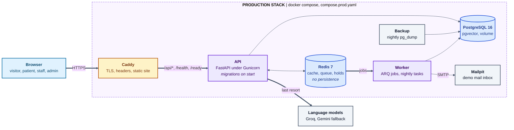

# Architecture

The full component diagram, with the chat orchestration inside the API, is in the [README](../README.md#architecture).

In development the Vite dev server proxies `/api` and `/health` to the API container, so the browser uses a single origin and cookies behave as they will in production.

## Backend

- `app/core`: settings (`pydantic-settings`), structured JSON logging, request ID middleware, uniform error handling.
- `app/db`: async SQLAlchemy engine and session factory, declarative models in `models/`, native enums in `enums.py`, and Alembic migrations in `migrations/`. See [database.md](database.md).
- `app/api`: unversioned operational routes (`/health`, `/ready`) and the versioned `/api/v1` router.
- `app/jobs`: ARQ worker settings and tasks.

Dependencies reachable from the request are held on `app.state` (settings, engine, session factory, Redis client) and created in the application lifespan, which keeps tests free of global state.

## Frontend

- `src/app`: providers and route table. Pages are code split with `React.lazy`.
- `src/lib/api-client.ts`: typed fetch wrapper. Types in `src/lib/api-types.ts` are generated from the backend OpenAPI schema with `npm run gen:api` and are never edited by hand.
- `src/styles/globals.css`: Tailwind v4 theme tokens for the brand palette and self hosted fonts.
- `src/components/ui`: shadcn/ui style primitives built on Radix.
